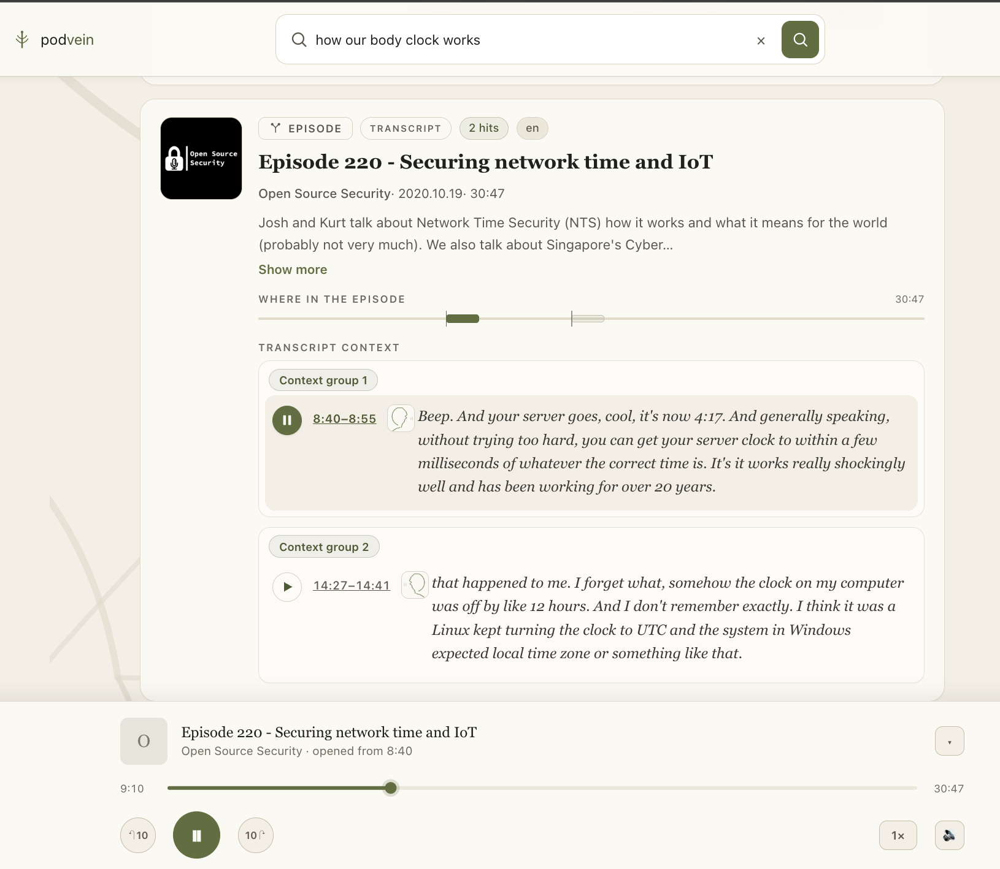

# Tien Ru (Terri) Chen

I'm a backend and full-stack engineer. I build web APIs, data integrations, search systems, and LLM extraction pipelines with evaluation. I write about them on my [blog](https://ctienru.github.io).

## [Podvein](https://podvein.com)

Podvein searches podcast transcripts in Chinese and English and plays audio from the matching timestamp. I built the search service with OpenSearch and the web app with Next.js.

## [LLM Evidence Checker for the Medicare GLP-1 Bridge](https://github.com/ctienru/bridge-evidence-check)

I built a Python CLI that checks chart evidence before attestation for the Medicare GLP-1 Bridge. An LLM only extracts fields and quotes. Deterministic code verifies every quote against the source text, applies versioned decision tables based on CMS guidance, and reports an evidence status for each condition. On the 7-variant dev set, there were zero false supports across the 112 condition rows labeled non-supported. The repository has the [dev and holdout results](https://github.com/ctienru/bridge-evidence-check#3-results) and the [public pull request history](https://github.com/ctienru/bridge-evidence-check/pulls?q=is%3Apr+is%3Amerged).

---

## Podvein details

I built Podvein independently. The code is in private repositories.

[Architecture](#architecture) · [Retrieval](#retrieval) · [Evaluation](#evaluation)

### What it does

- Search transcript passages, shows, and episodes.
- Read the matching passage with its nearby context.
- Play the episode from the passage's timestamp.
- Use the interface in English or Traditional Chinese.




---

### Architecture

```text
ONLINE

+------------------+    +------------------+    +-------------------+    +---------------------+
| Web app + BFF    |--->| Public API       |--->| Search service    |--->| OpenSearch          |
| Next.js / TS     |    | Django REST      |    | Python / FastAPI  |    | passages: BM25 +    |
| Vercel           |    | Framework        |    | query embedding   |    |   vectors           |
+------------------+    +------------------+    | on CPU            |    | shows, episodes     |
                                                +-------------------+    +----------^----------+
                                                                                    |
OFFLINE                                                                       indexed from
                                                                                    |
+--------------------------------------+         immutable corpus releases          |
| Ingest (PostgreSQL)                  |--------------------------------------------+
| RSS -> audio -> ASR -> passages      |         show and episode metadata export
+--------------------------------------+
```

- The browser sends all API requests through the web app's same-origin backend (BFF).
- The Django API calls the search service's internal API with a workload token.
- The search service and OpenSearch run with Docker Compose behind an Nginx edge on DigitalOcean. The frontend runs on Vercel.
- Ingestion runs step by step from a CLI. Speech recognition runs offline on Apple silicon with a pinned pretrained model.
- Ingestion publishes immutable releases. The serving indexes are built from those releases.
- The site's show and episode metadata come from the current ingestion pipeline. The transcripts were produced by an earlier pipeline. The current pipeline has run end to end on real audio, and the transcripts have not been regenerated with it yet.

**Stack:** Next.js · TypeScript · Django REST Framework · FastAPI · OpenSearch · multilingual-E5 · PostgreSQL · Docker Compose · Nginx · Vercel · GitHub Actions

---

### Retrieval

```text
                         Query
                           |
             +-------------+-------------+
             |                           |
             v                           v
      BM25 (ICU analysis)        multilingual-E5 query vector
             |                           |
             |                           v
             |                  exact cosine over passages
             |                           |
             +-------------+-------------+
                           |
                           v
            Reciprocal Rank Fusion (k = 60)
          keep passages found by both paths
                           |
                           v
          Group by episode (up to 3 passages)
                           |
                           v
          Episode + passage + timestamp
```

- **BM25:** OpenSearch ICU tokenizer and folding for mixed Chinese and English text.
- **Dense:** `multilingual-e5-large`. Serving uses exact cosine over all passage vectors.
- **Fusion:** I implemented reciprocal rank fusion in the search service.
- **Shows and episodes:** separate BM25 indexes over titles, authors, and descriptions.

---

### Evaluation

- **Queries:** 42 frozen queries, 21 Chinese and 21 English.
- **Judgments:** graded 0–3 per episode. All labels are LLM-provisional. Human verification is pending.
- **Metrics:** nDCG@10, MRR@10, and Recall@10 with ir-measures. Comparisons use a paired bootstrap with 10,000 resamples.
- **Traceability:** each run records dataset, corpus, and code versions. The evaluator refuses to compare incompatible runs.

| Method | nDCG@10 |
| --- | ---: |
| BM25 | 0.7909 |
| Dense | 0.7688 |
| Hybrid (RRF) | 0.8504 |

- These are the v5 OpenSearch results on a frozen evaluation corpus.
- I compared v5 with the previous version on the same queries. No difference reached p < 0.05.
- Differences between methods are descriptive until the labels are verified by a human.

**CI gate:** CI indexes a synthetic corpus into a real OpenSearch container. For BM25, dense, and hybrid, every per-query nDCG@10 must equal a committed baseline, or the build fails.

---

### How I build Podvein

I use a coding agent to develop Podvein. I review generated changes against acceptance criteria and check retrieval behavior with frozen queries before shipping.
