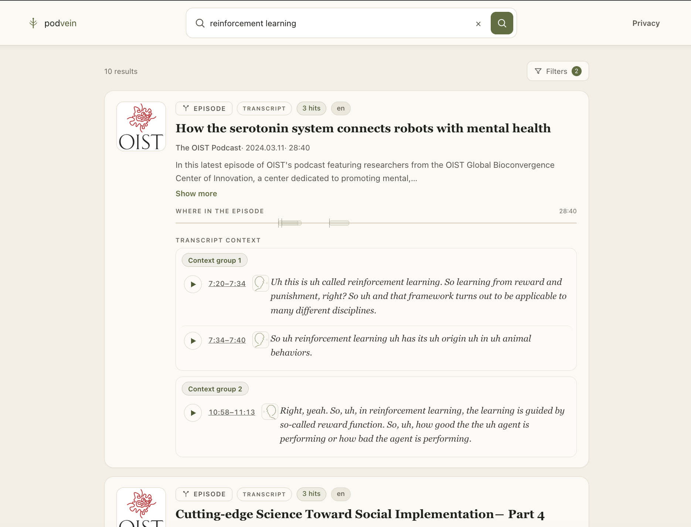

# Podvein — Bilingual Podcast Search

**Find the moment, not just the episode.**

Podvein searches podcast transcripts in Chinese and English. It returns the matching passage and plays the episode from that passage's timestamp.

- Live: https://podvein.com
- Blog: https://ctienru.github.io
- Built independently by Tien Ru (Terri) Chen. The code is in private repositories.

[Architecture](#architecture) · [Retrieval](#retrieval) · [Evaluation](#evaluation)

---

## What it does

- Search transcript passages, shows, and episodes.
- Read the matching passage with its nearby context.
- Play the episode from the passage's timestamp.
- Use the interface in English or Traditional Chinese.




---

## Architecture

```text
ONLINE

+------------------+    +------------------+    +-------------------+    +---------------------+
| Web app + BFF    |--->| Public API       |--->| Search service    |--->| OpenSearch          |
| Next.js / TS     |    | Django REST      |    | Python / FastAPI  |    | passages: BM25 +    |
| Vercel           |    | Framework        |    | query embedding   |    |   vectors           |
+------------------+    +------------------+    | on CPU            |    | shows, episodes     |
                                                +-------------------+    +----------^----------+
                                                                                    |
OFFLINE                                                                       indexed from
                                                                                    |
+--------------------------------------+         immutable corpus releases          |
| Ingest (PostgreSQL)                  |--------------------------------------------+
| RSS -> audio -> ASR -> passages      |         show and episode metadata export
+--------------------------------------+
```

- The browser only calls the web app's same-origin backend (BFF). It never calls the search service.
- The Django API calls the search service's internal API with a workload token.
- The search service and OpenSearch run with Docker Compose behind an Nginx edge on DigitalOcean. The frontend runs on Vercel.
- Ingestion runs step by step from a CLI. Speech recognition runs offline on Apple silicon with a pinned pretrained model.
- Ingestion publishes immutable releases. Serving reads releases, not live ingestion state.
- The transcripts on the site today still come from the previous version's pipeline. The v5 ingestion pipeline has run end to end on real audio, and it produces the show and episode metadata.

**Stack:** Next.js · TypeScript · Django REST Framework · FastAPI · OpenSearch · multilingual-E5 · PostgreSQL · Docker Compose · Nginx · Vercel · GitHub Actions

---

## Retrieval

```text
                         Query
                           |
             +-------------+-------------+
             |                           |
             v                           v
      BM25 (ICU analysis)        multilingual-E5 query vector
             |                           |
             |                           v
             |                  exact cosine over passages
             |                           |
             +-------------+-------------+
                           |
                           v
            Reciprocal Rank Fusion (k = 60)
          keep passages found by both paths
                           |
                           v
          Group by episode (up to 3 passages)
                           |
                           v
          Episode + passage + timestamp
```

- **BM25:** OpenSearch ICU tokenizer and folding for mixed Chinese and English text.
- **Dense:** `multilingual-e5-large`. Serving uses exact cosine over all passage vectors. I studied HNSW but do not use it in serving.
- **Fusion:** RRF is implemented in the search service, not with OpenSearch's built-in fusion.
- **Shows and episodes:** separate BM25 indexes over titles, authors, and descriptions.

---

## Evaluation

- **Queries:** 42 frozen queries, 21 Chinese and 21 English.
- **Judgments:** graded 0–3 per episode. All labels are LLM-provisional. Human verification is pending.
- **Metrics:** nDCG@10, MRR@10, and Recall@10 with ir-measures. Comparisons use a paired bootstrap with 10,000 resamples.
- **Traceability:** each run records dataset, corpus, and code versions. The evaluator refuses to compare incompatible runs.

| Method | nDCG@10 |
| --- | ---: |
| BM25 | 0.7909 |
| Dense | 0.7688 |
| Hybrid (RRF) | 0.8504 |

- These are the v5 OpenSearch results on a frozen evaluation corpus.
- I compared v5 with the previous version on the same queries. No difference reached p < 0.05.
- Differences between methods are descriptive until the labels are verified by a human.

**CI gate:** CI indexes a synthetic corpus into a real OpenSearch container. For BM25, dense, and hybrid, every per-query nDCG@10 must equal a committed baseline, or the build fails.

---

## How I build

I develop with Claude Code. I review generated changes against acceptance criteria and check retrieval behavior with frozen queries before shipping.
